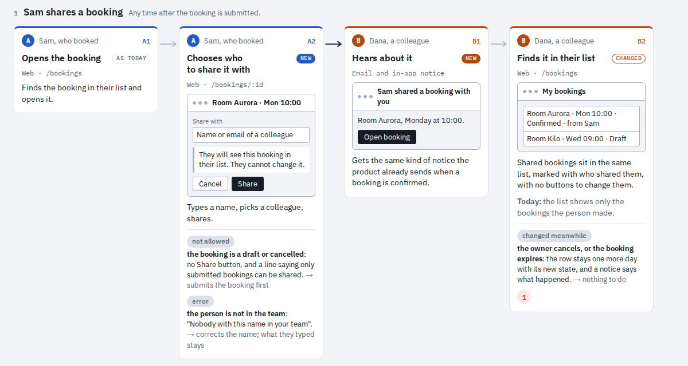
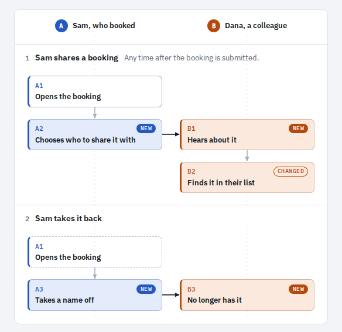
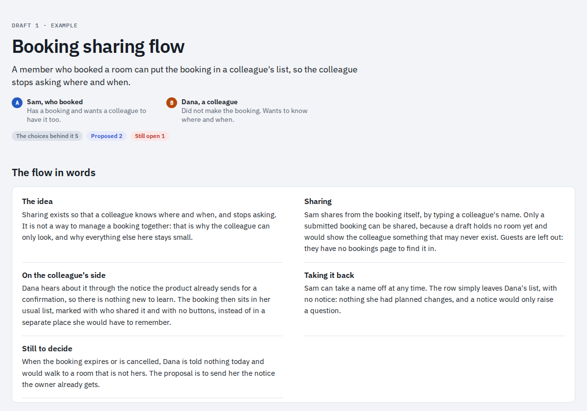

<p align="center">
  <picture>
    <source media="(prefers-color-scheme: dark)" srcset="assets/filo-dark.svg">
    
  </picture>
</p>

<p align="center">
  <b>Decide the flow before the code.</b><br>
  A Claude Code plugin that interviews you about a feature, one question at a time,<br>
  and draws the flow you decided.
</p>

<p align="center">
  
  
  <a href="LICENSE"></a>
</p>

---

Coding agents are good at building what you describe. They are much worse at noticing what you did not describe: the colleague who is never told, the state no screen shows, the choice that contradicts one you made last week. Those gaps are why a product stops feeling like it hangs together.

**filo** (Italian for *thread*) adds the missing seat to the session: a mix of a senior developer and a flow manager. It reads how your system really works, leads you through the flow with small concrete questions, stops you when two answers do not fit, and hands back one page you can read in two minutes. Only when you approve that page is anything saved, and only then does code start.

<p align="center">
  
</p>

> **Beta.** filo works and has been used to decide real features, but it is young: the file format and the page may still change before 1.0. See [Status](#status).

## What a session looks like

1. **It reads first.** Roles, screens, states, errors, timed jobs, past decisions. The cases come from your code, not from imagination. You are asked nothing the code could have answered.
2. **It opens in six lines**, then asks. One question at a time, each a concrete situation with two to four ways it could go, one of them recommended, and at least one you had not thought of.

   ```
   5 of about 11
   Anna shared her booking with Marco. That night nobody confirms it and it expires.
   Today Marco is told nothing: the row in his list just changes.
   What should Marco see?

   A. A notice, the same one Anna gets. (Recommended: a shared booking that fails in
      silence sends him to a room that is not his.) Small: one more notice.
   B. Only the new state in his list. Nothing to build, and he finds out if he looks.
   C. The booking leaves his list. The simplest screen; he will wonder where it went.
   ```

3. **It checks every answer** against the earlier ones, against what was already decided, and against how the product works. When something does not fit, it stops:

   ```
   Two of your answers do not fit together.
   Earlier: "a colleague can only look at a shared booking".
   Now: "the colleague cancels it when the meeting is off".
   Cancelling is changing it. Which one holds?
   ```

4. **You can stop whenever you like.** "You choose" is a valid answer. Whatever is left takes its recommendation, marked as its own choice so you can object later.
5. **It draws the flow as one page**: the flow explained in words, a map, the life of the main object, a storyboard with the screens that change, every choice and who made it, and a table where every case the system knows has an answer.
6. **You approve, it saves.** The flow goes into `product/flows/<name>.md` with its choices and acceptance scenarios, followed by a short build plan. No product code is written before this point.

A whole feature takes eight to fifteen questions.

## The page

The page is the same every time, so the tenth flow reads as fast as the first. It is drawn from data: the plugin never hand-draws a diagram.

| | |
|---|---|
|  |  |
| **The map.** One column per person, one band per moment. A dark arrow is a handoff. | **The flow in words.** What was decided, why, and what follows from it. |

Below them: the life of the main object, the storyboard shown above, every choice with who made it, and a table where every case the system knows has an answer.

More in [docs/page.md](docs/page.md).

## Install

In Claude Code:

```
/plugin marketplace add marco-bertelli/filo
/plugin install filo@filo
```

Or from a terminal:

```bash
claude plugin marketplace add marco-bertelli/filo
claude plugin install filo@filo
```

To try it without installing, clone the repository and start Claude Code with `claude --plugin-dir /path/to/filo`.

## Use

| Command | What it does |
|---|---|
| `/filo:flow` | Starts the interview. You can also just describe the feature: *"before we build sharing, let's go through the whole flow"*. |
| `/filo:page [name]` | Draws the page of a flow that is already decided (saved in the project, or built in this conversation). Asks nothing. |

Start in the repository of the product. If the product lives in several repositories, start in the one where you want the flows kept and say where the others are.

A first session, step by step: [docs/getting-started.md](docs/getting-started.md).

## What gets saved

One Markdown file per flow, in your repository, readable by people and by the next coding session:

```markdown
# Booking sharing

Approved 2026-11-13. Replaces: nothing.

## Purpose
## The flow in words
## Actors
## Flow            every step, per actor, with its screen and its failure cases
## Paths           the moments, as ordered step ids
## Life of a booking
## Choices         each with who made it, why, and what was discarded
## Coverage        every case the system knows, and its answer
## Out of this flow
## Scenarios       Given / when / then: the acceptance test
```

The scenarios are the contract for the build: after implementation, each one either happens as written or is a deviation to bring back to you. Format reference: [docs/flow-file.md](docs/flow-file.md).

## When to use it

- A new feature that touches more than one screen or more than one kind of person.
- An existing feature that feels unfinished, confusing or inconsistent.
- Before a planning or implementation skill, to give it something decided to plan from.

Not for bug fixes, refactors or one-field changes: nothing a person sees or can do changes, so there is no flow to decide.

## Status

Beta, version `0.1.0-beta.1`.

- **Used for real**, on features of a multi-repository product, and checked with scripted multi-turn sessions and rendered pages. Not yet used widely: expect rough edges on stacks and products unlike the ones it grew up on.
- **Depends on the model.** The reading and the contradiction check are as good as the model running them. Use a strong one.
- **The page needs somewhere to appear.** In Claude Code it is published with the Artifact tool; elsewhere you get the path of an HTML file to open.
- **The flow file format may change** before 1.0. `/filo:page` already redraws files saved by an older version.
- **Not built yet:** a check that walks the built feature against the saved flow; more test cases than the two in `evals/`.

Problems and ideas are welcome in the [issues](https://github.com/marco-bertelli/filo/issues). A transcript of the question that went wrong is the most useful thing you can attach.

## Documentation

- [Getting started](docs/getting-started.md): install, a first session, what to do afterwards.
- [The interview](docs/interview.md): how it reads, what it asks, how it catches contradictions.
- [The page](docs/page.md): its parts, its data, translating and redrawing it.
- [The flow file](docs/flow-file.md): the saved format and how to build from it.
- [Contributing](CONTRIBUTING.md) and [Changelog](CHANGELOG.md).

## What is in the repository

```
skills/flow/SKILL.md               the interview
skills/flow/references/lenses.md   what to collect from the system, and the questions asked at every step
skills/flow/assets/flow-page.html  the page: only its <title> and its JSON block change
skills/page/SKILL.md               drawing the page of a flow that exists
evals/                             test cases, in the layout `claude plugin eval` reads
docs/                              the documentation
```

## Acknowledgements

The idea of a small repository of skills that changes how a coding session goes owes a lot to [superpowers](https://github.com/obra/superpowers). filo tries to do for product flows what that does for engineering practice.

## Licence

[MIT](LICENSE).
