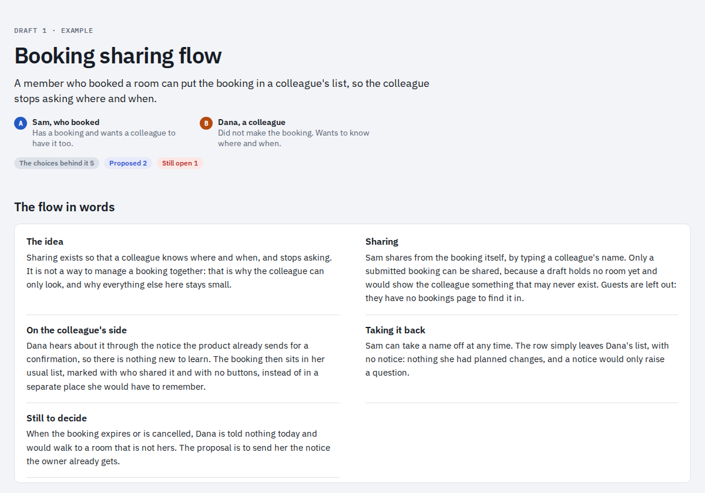

# The page

The page is how a decided flow is shown: at the end of an interview, or at any later time with `/filo:page`. It is one self-contained HTML file. In Claude Code it is published with the Artifact tool; elsewhere you get the file's path.

The page is a working view. What is kept is the [flow file](flow-file.md), which holds everything the page shows.

## Its parts



**The header.** The flow's name, what it is for in one sentence, and the cast: each person with a letter and a colour that follow them down the page.

**The flow in words.** Five to nine short parts: the idea, each main moment, how it ends, what does not change. Each says what was decided, why, and what follows, including the consequences nobody asked about. Somebody who reads only this should know how the flow works.


**The map.** One column per person, one band per moment (setting it up, everyday use, each other way in, each way it ends). A dark arrow is a handoff: the flow passes to somebody else. A step already met in an earlier band is drawn dashed. Filled tag: the step is new. Outlined tag: it changes.

**The life of the main object.** Its states on a line, in the order of a normal life, with the jumps drawn as arcs. Only when the object has more than two states.


**Step by step.** One strip of frames per moment. Each frame says who, where, what they see and do, what happens there today when it changes, and the cases that can go differently (empty, error, not allowed, waiting), each with its way out. A screen that is new or changes gets a small sketch.

**Still open.** Only if something is. Each open point has its options; you can pick them on the page and copy your answers back into the chat.

**The choices behind it.** Every choice, grouped by who made it: you, the model (proposed, open to objection), or decided before the session.

**Cases covered.** A folded table: every case the system knows (each actor, state, failure, timed event, surface) and its answer: covered by a step, not supported with what the person sees instead, or open.

**Out of this flow.** What was left out on purpose.

The page works at phone width and in light and dark themes.

## `/filo:page`

```
/filo:page            the flow of this conversation, or the only saved one
/filo:page bookings   a saved flow, by name
```

It asks nothing and decides nothing. It takes, in order: the page built earlier in the conversation, a saved flow file, or tells you there is no flow yet. It always starts from a fresh copy of the template, so a flow saved months ago is redrawn with today's page.

When the file was saved by an older version and lacks something (no paths, no "flow in words"), it rebuilds that part from what the file does say and tells you in one line.

## How it is drawn

The template is [`skills/flow/assets/flow-page.html`](../skills/flow/assets/flow-page.html). The model changes two things in it: the `<title>` and one JSON block. The page draws everything from that data, so no diagram is ever written by hand and no text is ever cut: the boxes are HTML and the lines are an SVG layer drawn over their measured positions.

The data, in short:

| Field | Holds |
|---|---|
| `title`, `status`, `value` | the name, where the work stands, what the feature is for |
| `summary[]` | the flow in words: `{ title, text }` parts |
| `labels` | the page's fixed words, translated into your language |
| `actors[]` | `name`, `who`, and their `steps[]` |
| `steps[]` | `id` (a letter per actor and a number: `A1`, `B2`), `title`, `where`, `change` (`new`, `changed`, `same`), `screen` (the sketch), `what`, `today`, `branches[]`, `points` |
| `paths[]` | one per moment: `title`, `when`, and the step ids in the order things happen, across actors |
| `states` | the life of the main object: `nodes[]` and `edges` |
| `decisions[]` | each choice: the question, the answer, and `by` (`you`, `me`, `before`) |
| `points[]` | what is still open, with options and a recommendation |
| `coverage[]` | each case, its source in the code, its answer |
| `out[]` | what is out of the flow |

A path never forks. Two alternatives are two paths; a different outcome at the same steps is a branch of the step. This is what keeps the map honest: alternatives written as one path would be drawn as a sequence that never happens.

A screen sketch is a list of blocks: a title bar, lines of text, fields, rows, buttons, system notes, placeholders. The full description of every field is in the comment above the JSON block in the template, next to a worked example.

## Changing the look

The skills are told not to restyle the page: the same look every time is what makes the tenth flow as quick to read as the first. To change it for your team, edit the template (colours are tokens at the top of its `<style>`), then check it as [CONTRIBUTING.md](../CONTRIBUTING.md) describes: on data of a real flow's size, rendered and looked at.
